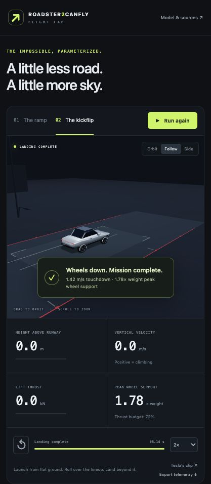

# Roadster2CanFly

A small browser flight lab inspired by Tesla’s Roadster ramp and kickflip demonstrations. Recreate the sequence, adjust the physics, and see whether the car still lands.

**Two successful default presets. A static website. No simulation server.** Runs on an Apple Silicon Mac in a WebGL 2-capable browser. All artwork is generated in code, so no car models, textures, or video downloads are needed.



## Run on your Mac

Use Node.js 22.12+ (or a newer supported Node release).

```sh
npm ci
npm run dev
```

Open the local URL printed by Vite, normally `http://127.0.0.1:5173/`. Click **Run demo**. Use **Orbit**, **Follow**, or **Side** to inspect the stunt, and select slow motion to see the landing. Space pauses/resumes when focus is outside a control; R resets.

```sh
npm test          # physics and parameter validation
npm run build    # produces the standalone static website in dist/
npm run preview  # serves the production build locally
npm run check:size
```

The size check enforces a **1 GB project budget**, including source, installed dependencies, and the production build, excluding `.git`. Browser/OS storage and exported user files are separate. The deployed site contains only `dist/`; `node_modules/` is not deployed. Dependencies are pinned and locked.

## What you can change

- **Flight:** launch speed, ramp or jump height, ramp exit angle, target flight time, rotation duration.
- **Vehicle and actuation:** mass, center of mass, lift thrust cap, attitude torque cap, shared thrust budget.
- **Landing:** spring stiffness, damping, suspension travel, friction.
- **Environment:** drag area and wind along the runway.
- **Assistance:** independently enable altitude tracking and attitude control.

Changes reset the simulation. **Restore successful preset** returns the current scene to its tested defaults. Save/load a JSON setup or copy a URL containing the setup. Export the run’s telemetry as CSV.

## What “recreate” means here

The night runway, overhung ramp, airborne recovery, five-vehicle lineup, roll, and landing follow the visible sequence in Tesla’s official clips:

- [The Ramp](https://www.youtube.com/watch?v=7p5LxFdc-Qg)
- [The Kickflip](https://www.youtube.com/watch?v=r5vsHHPVhJg)
- [Roadster Event](https://www.youtube.com/watch?v=qt5p-_tE8d0), October 15, 2026: ramp chapter at 6:03, kickflip at 10:56.

**The defaults are tuned assumptions, not Tesla engineering specifications or an independently validated reconstruction.** Tesla’s clips include edits/replays and do not supply calibrated trajectory, mass, thrust, or suspension data. The model does not test the real car’s safety or establish that Tesla used the assumed actuation system.

The driven approach and adhesion to the overhung ramp are prescribed. After release, Rapier integrates forces and torques on a rigid chassis at **240 Hz**. Four spring-damper wheel contacts handle landing support and friction. Lift and rotation control use bounded idealized actuators and consume a shared impulse budget. Parameter changes can cause collisions, insufficient lift, hard landings, or an incomplete stunt.

See [the model and its assumptions](docs/MODEL.md) for equations, defaults, criteria, and limitations.

## Project layout

```text
src/config.js       Parameter schema, presets, and scene dimensions
src/simulation.js   Physics, controllers, contact, and outcomes
src/scene.js        Procedural Three.js artwork and cameras
src/main.js         Controls, playback, configuration, and CSV export
src/style.css       Responsive interface
tests/              Repeatable physics acceptance tests
scripts/            Project-size check
docs/               Model documentation
```

Stack: [Three.js](https://threejs.org/), [Rapier](https://rapier.rs/), plain JavaScript, and Vite. No analytics, accounts, external model requests, or cloud computation. The reference videos open on YouTube only when selected.

Independent fan project, not affiliated with or endorsed by Tesla or SpaceX. Vehicle and scene artwork are original procedural approximations.
